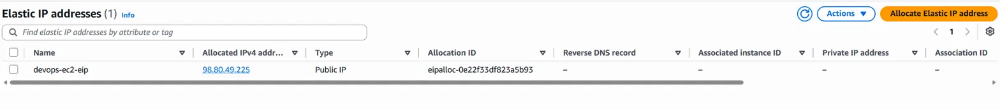
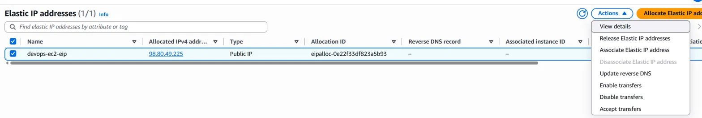
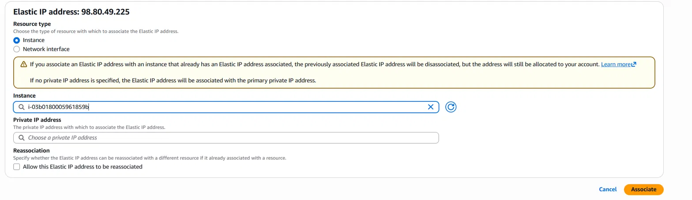
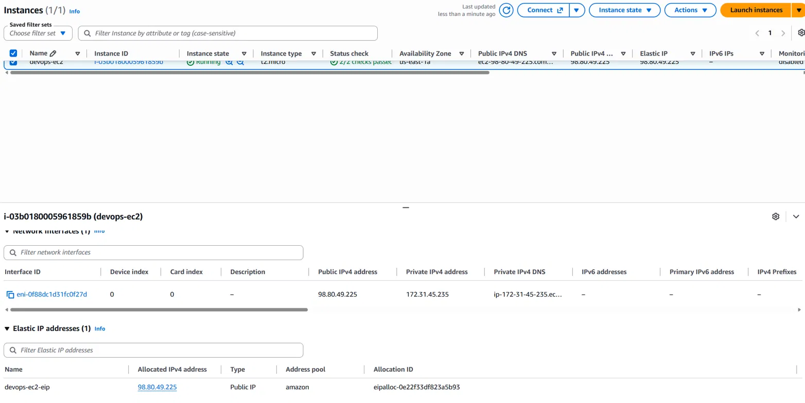

[← Back to KodeKloud 100 Days](/kodekloud)

# Overview

The Nautilus DevOps team is breaking their AWS migration down into smaller tasks, which gives them better control, less risk and better use of resources along the way.

There is an instance named `devops-ec2` and an Elastic IP named `devops-ec2-eip` in the `us-east-1` region. Attach `devops-ec2-eip` to `devops-ec2`.

# What is an Elastic IP?

An Elastic IP is a static public IPv4 address that we allocate to our AWS account and then associate with an instance.

The reason it's useful is that it doesn't change. A normal auto-assigned public IP changes every time an instance is stopped and started, but an Elastic IP stays the same for as long as we hold it. That means DNS records, firewall allow lists and other services can point at a fixed address without breaking after a restart. During a migration, it lets the team set an endpoint once instead of chasing a changing IP.

# Solution

Heading over to **EC2 > Elastic IPs**, we can see `devops-ec2-eip` with the IP `98.80.49.225`. The Associated instance ID column is empty, so it isn't attached to anything yet.

With `devops-ec2-eip` selected, open **Actions > Associate Elastic IP address**. Associating is the action that ties the address to a resource.

On the Associate page, set **Resource type** to **Instance**, then search for and select `devops-ec2` in the Instance field. I left the private IP field empty, so AWS uses the instance's primary private address.

Choose **Associate** to apply it.

To confirm it worked, go to **Instances** and select `devops-ec2`. The Elastic IP column and the instance's public IPv4 address both show `98.80.49.225`, and `devops-ec2-eip` is listed under the instance's Elastic IP addresses, which proves the association is live.

# Notes

AWS charges for every public IPv4 address, including Elastic IPs, whether or not they're attached to anything. Unused Elastic IPs should be released so they don't sit on the bill.

The "Allow this Elastic IP address to be reassociated" box was left unticked. That stops the address being moved to a different resource by accident later.
