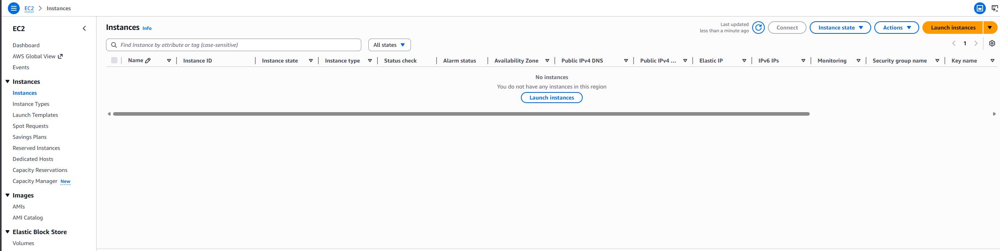
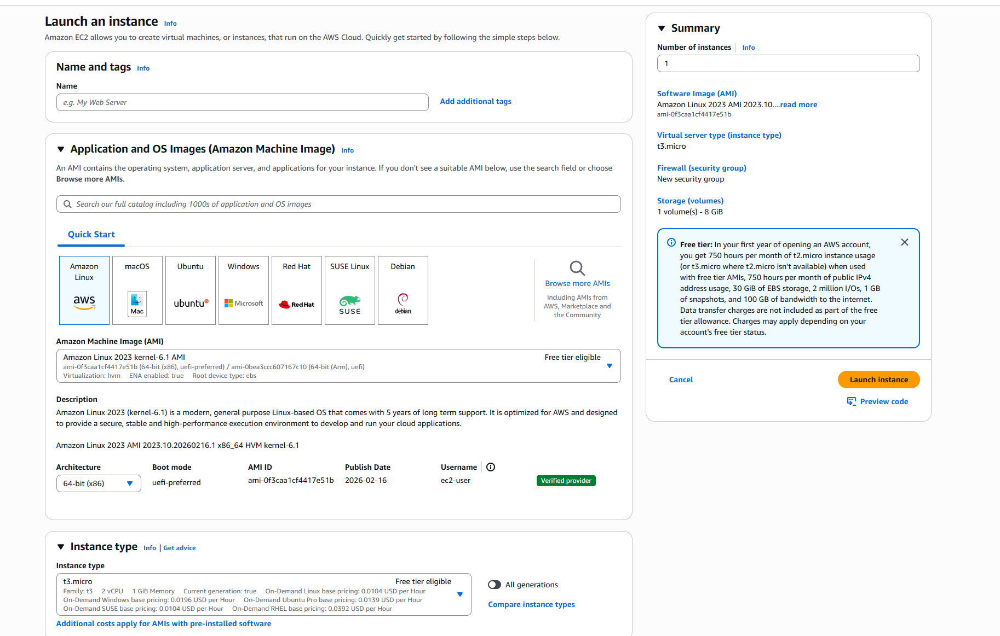
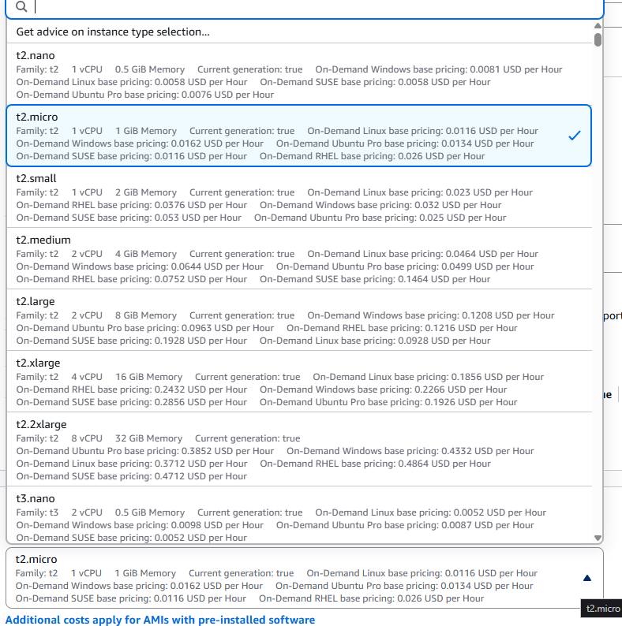
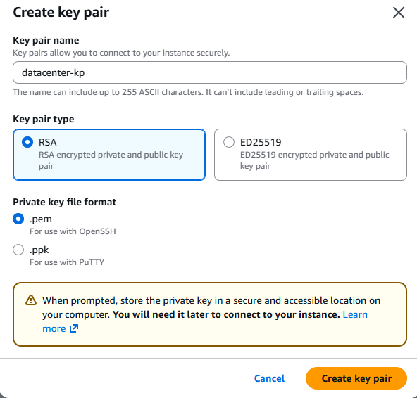
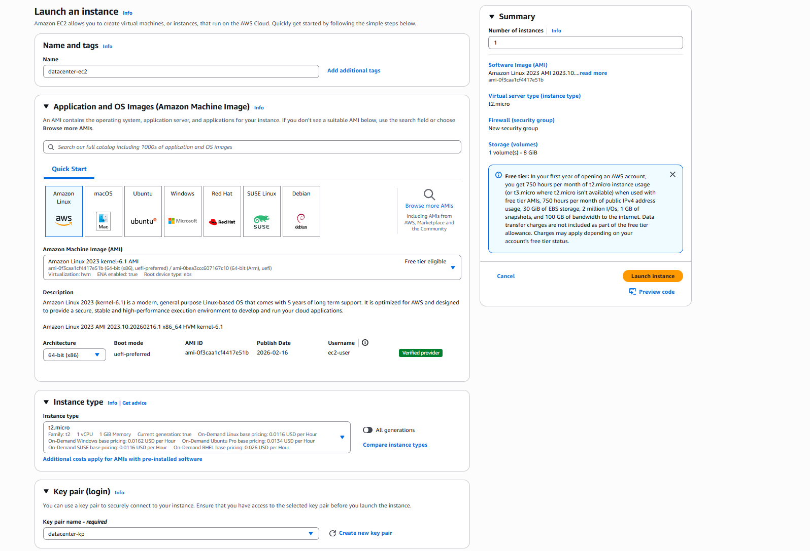
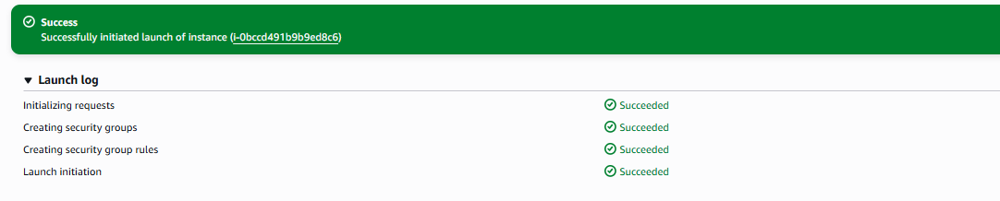
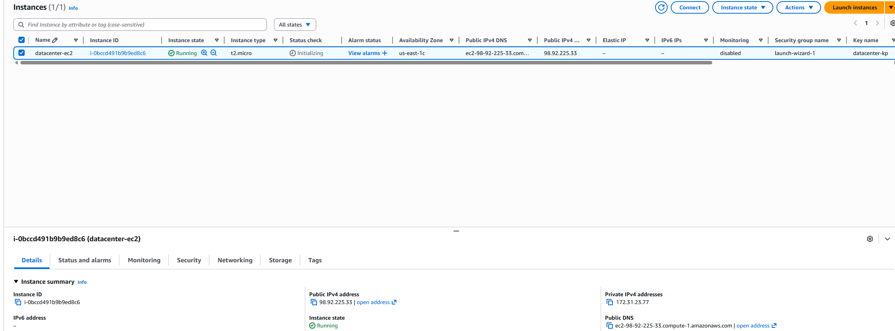
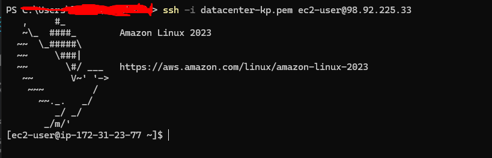

# Overview

For this task, create an EC2 instance with following requirements:

1) The name of the instance must be `datacenter-ec2`.

2) You can use the `Amazon Linux` AMI to launch this instance.

3) The Instance type must be `t2.micro`.

4) Create a new RSA key pair named `datacenter-kp`.

5) Attach the default (available by default) security group.


# What is Amazon EC2

Amazon EC2 is a service that provides resizable compute capacity in the cloud. Think of EC2 as virtual servers that you can launch in minutes, configure with your operating system and applications, and scale up or down based on your needs.
# Solution

Head over to EC2 > Instances - This is where we launch the instances


On the EC2 Dashboard, **"Launch instance"** - This is where we will be able to configure our instance


In the **"Name"** field, enter:`datacenter-ec2`

Amazon Linux is the default AMI and can be left

Under instance type select` t2.micro` from the dropdown


Now to create the RSA key pair, which needs to be named to `datacenter-kp`


Create key pair and it will automatically download our private key (Make sure to secure this as this is the only chance you get to download it)

If using Linux, you will need to set the correct permissions for the key if you need to SSH from your device. This can be done using this command
```sh
chmod 400 datacenter-kp.pem
```

For Windows:
```powershell
 icacls datacenter-kp.pem /inheritance:r
```

We can leave the other settings as default and can now launch our instance


The instance has successfully been launched


Now let's test our SSH key from earlier to SSH the instance

We will need the public IP address - Which is `98.92.225.33`


Now run:
```sh
ssh -i datacenter-kp.pem ec2-user@98.92.225.33
```

We have successfully logged in through SSH

