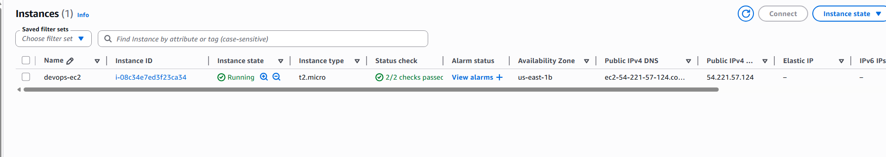

[← Back to KodeKloud 100 Days](/kodekloud)

# Overview

During the migration, the Nautilus team found that one of their EC2 instances was underused, so they decided to make it smaller. The status checks need to have finished before making any changes.

1. Change the instance type of `devops-ec2` from `t2.micro` to `t2.nano`
2. Make sure `devops-ec2` is `running` after the change

# What is an instance type?

The instance type decides how much CPU, memory, storage and network capacity an EC2 instance gets. Changing it is a normal part of right-sizing: making an instance bigger when it's struggling, or smaller when it's paying for capacity it doesn't use.

## t2.micro vs t2.nano

| | t2.nano | t2.micro | Change |
|---|---|---|---|
| **vCPUs** | 1 | 1 | Same |
| **Memory** | 0.5 GiB | 1 GiB | -50% |
| **CPU credits/hour** | 3 | 6 | -50% |
| **Price (on-demand)** | ~$0.0058/hour | ~$0.0116/hour | -50% |
| **Price (monthly)** | ~$4.25/month | ~$8.50/month | -50% |

Half the cost for half the memory, which is worth it if the instance isn't using what it has.

# Solution

Head over to EC2 to view the instance.

The instance has to be stopped before the type can be changed: **Instance state > Stop instance**. After a few seconds it shows as stopped.

With it stopped, select the instance and go to **Actions > Instance settings > Change instance type**, then change it from `t2.micro` to `t2.nano`.

Now the instance can be started again: select `devops-ec2` > **Instance state > Start instance**.

After a few seconds the instance is running with 2/2 checks passed and the new instance type.

# Notes

Stopping the instance means downtime, so on a real server this would need to be planned in. Also, unless the instance has an Elastic IP, its public IP changes when it's stopped and started.
