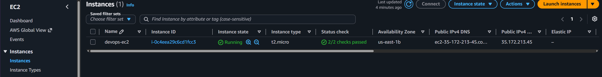
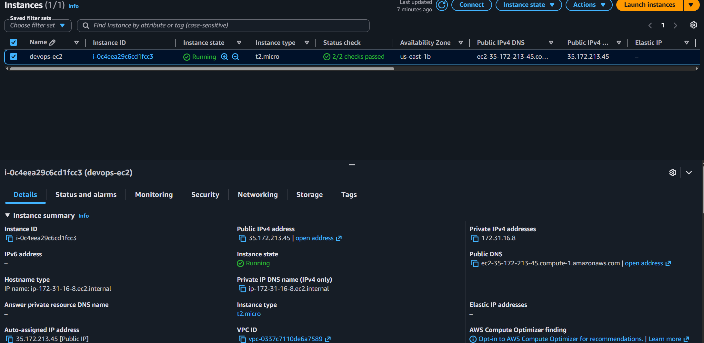
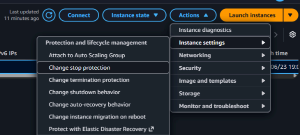
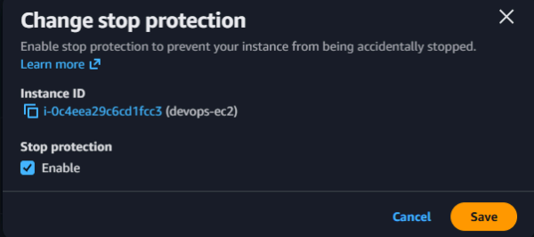

[← Back to KodeKloud 100 Days](/kodekloud)

# Overview

As part of the migration, some components were added to the AWS account, and one of the EC2 instances needs changing.

There is an EC2 instance named `devops-ec2` in the `us-east-1` region. Enable `stop` protection for this instance.

# What is EC2 stop protection?

Stop protection blocks an instance from being stopped through the console, CLI or API. It works through the `DisableApiStop` instance attribute. When it's on, anyone who tries to stop the instance gets an error until the protection is switched off.

This is useful during a migration, where a server holding data that hasn't finished moving could be knocked offline by one accidental click or a stray script. It turns stopping the server into a two-step action rather than a one-click mistake.

It's a separate setting from termination protection, which stops the instance being deleted.

# Solution

Head over to **EC2 > Instances**, which is where all of the instances live.

In the instances list, tick the checkbox next to `devops-ec2`. Selecting it is what lets the Actions menu act on this specific instance.

With the instance selected, open **Actions > Instance settings > Change stop protection**.

In the dialog that opens, tick **Enable** under Stop protection, then **Save**. Ticking Enable sets the `DisableApiStop` attribute to true.

To confirm it applied, reopen **Actions > Instance settings > Change stop protection**. The Enable box should already be ticked.

As a final check, try **Instance state > Stop instance**. AWS blocks it and returns a message saying the instance has stop protection enabled, which proves the setting is live.

