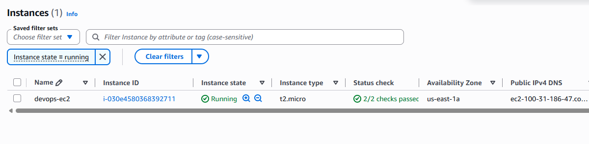
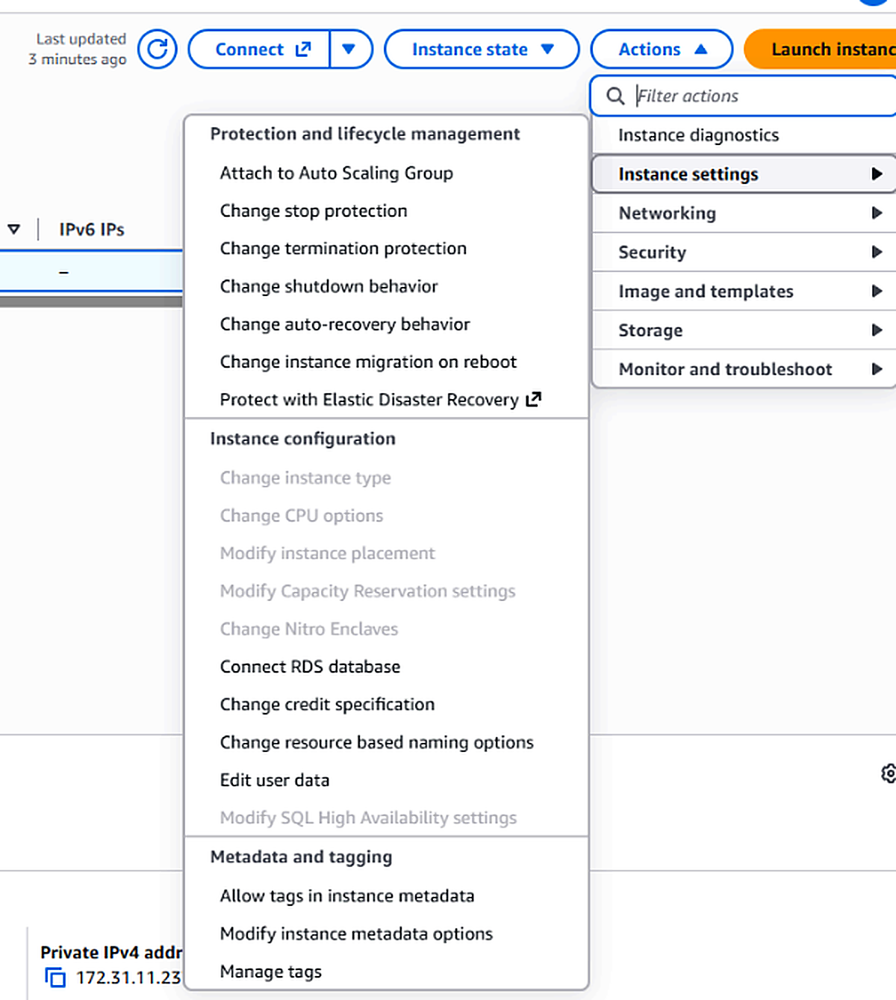
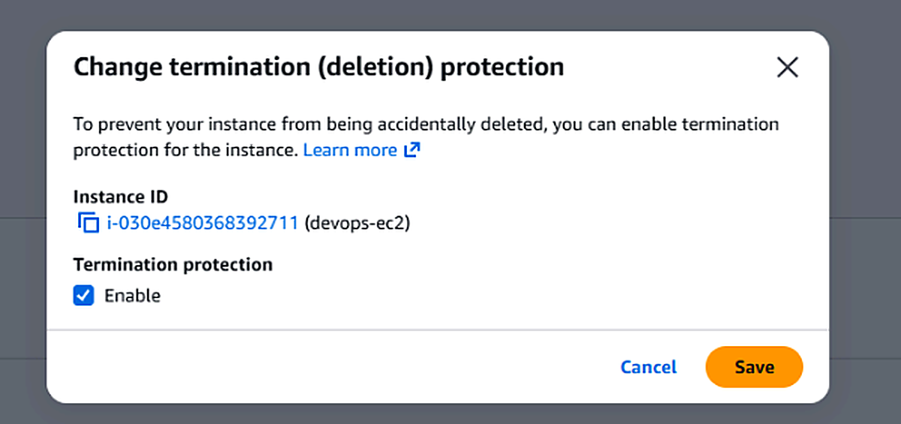

[← Back to KodeKloud 100 Days](/kodekloud)

# Overview

As part of the migration, some components were created in the AWS account. The Nautilus DevOps team created an EC2 instance but forgot to enable termination protection, which it needs.

An instance named `devops-ec2` already exists in the `us-east-1` region. Enable termination protection for it.

# What is termination protection?

Termination protection blocks an instance from being terminated through the console, CLI or API. It works through the `DisableApiTermination` instance attribute, which is off by default on every new instance. When it's on, anyone who tries to terminate the instance gets an error until the protection is switched off.

Terminating an instance is permanent, so this matters most for servers we intend to keep, like one carried through a migration. It turns terminating into a two-step action rather than a one-click mistake.

It's the partner to stop protection from [Day 8](/KodeKloud/100%20Days/AWS/Day%208%20-%20Enable%20Stop%20Protection%20for%20EC2%20Instance): stop protection stops the instance being shut down, termination protection stops it being deleted.

# Solution

Heading over to the running instances in EC2, we can see `devops-ec2`.

Select `devops-ec2` by ticking the checkbox next to it. Selecting it is what lets the Actions menu act on this specific instance.

With the instance selected, open **Actions > Instance settings > Change termination protection**, which is the menu that holds the setting we need.

Tick **Enable** and **Save**. Ticking Enable sets the `DisableApiTermination` attribute to true.

As a final check, try **Instance state > Terminate (delete) instance**. AWS blocks the action and says termination protection is enabled, which proves the setting is live.

# Notes

Termination protection doesn't cover everything. An instance can still be terminated if it's shut down from inside the OS while its shutdown behaviour is set to terminate, or if an Auto Scaling group removes it. For anything critical I'd also use IAM permissions to limit who can change these settings at all.
