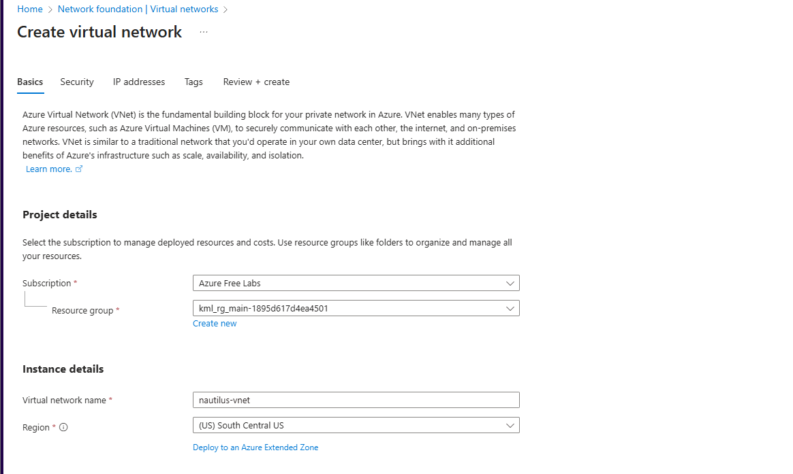
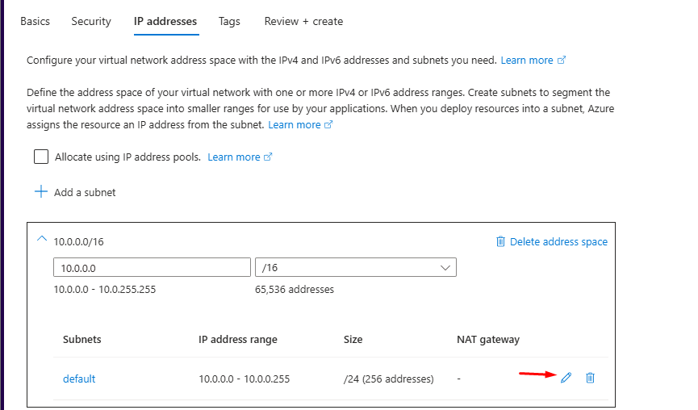
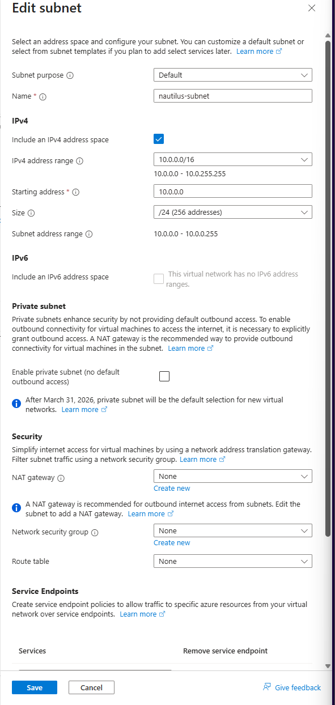
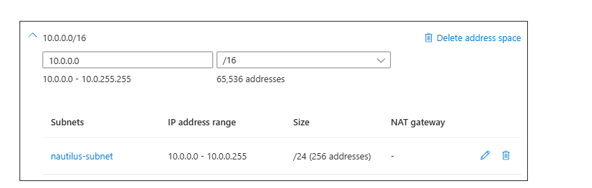
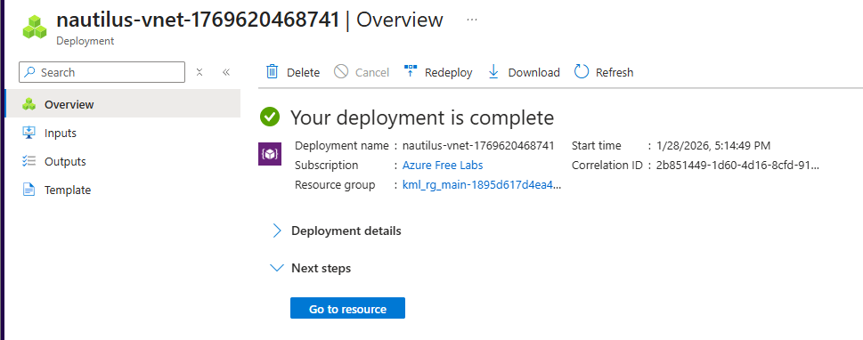

# Overview

For this task, create a Virtual Network (VNet) named `nautilus-vnet` and one subnet named `nautilus-subnet` within the VNet in the `southcentralus` region. Make sure the `IPv4 address range` is `10.0.0.0/16`.

# What is a subnet?

A subnet is a smaller range carved out of the VNet's address space. You put resources in subnets so you can group them and apply different rules to each group. For example, web servers in one subnet and databases in another, with an NSG controlling what can reach the databases.

# Solution

First, search for Virtual Networks in the search bar

On the Virtual networks page, click the **"+ Create"** button to begin VNet creation.

Add the virtual network name:
`nautilus-vnet`

Swap the region to:
`South Central US`

After all fields are filled in correctly, head to **IP Addresses** tab, which the IP we need to use is already the default(`10.0.0.0/16`). To create our subnet, we need to click the pencil icon to add it:

This will open up a sidebar - Which we can fill out the name to `nautilus-subnet`:

When it's saved, it will show up with the name, IP address range and size (How many IP addresses there are).

This can now be Reviewed and Created

Validation has passed, now we can fully create the virtual network. After around 20-30 seconds, the deployment will be completed:

