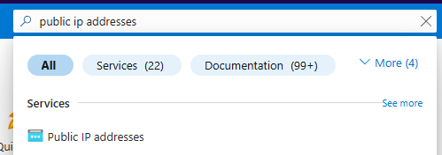
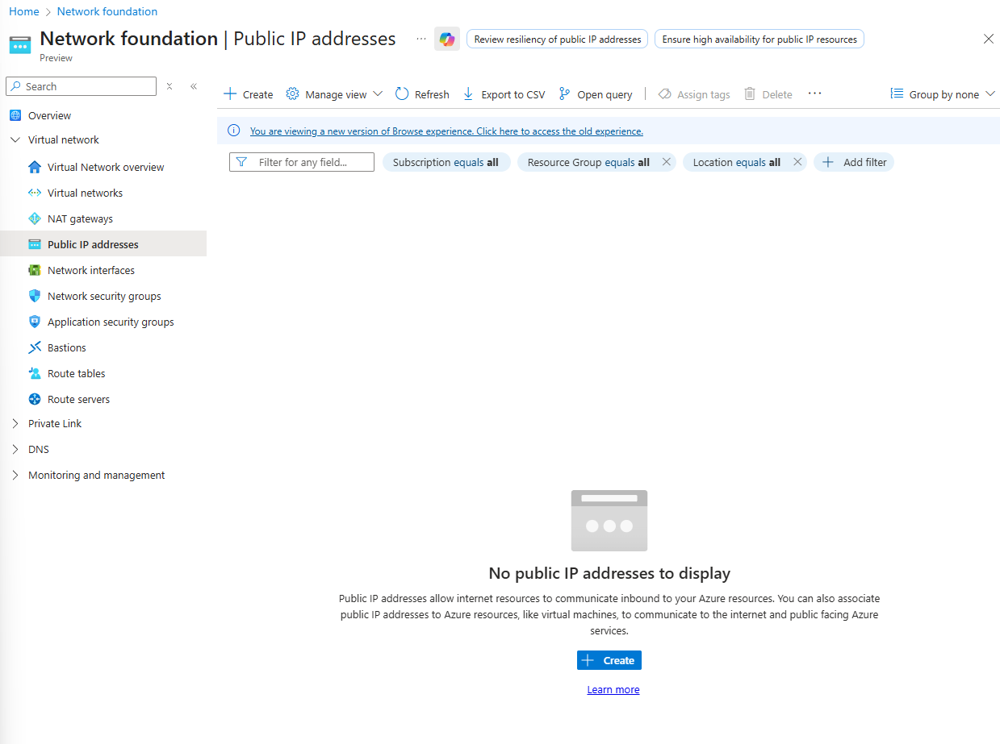
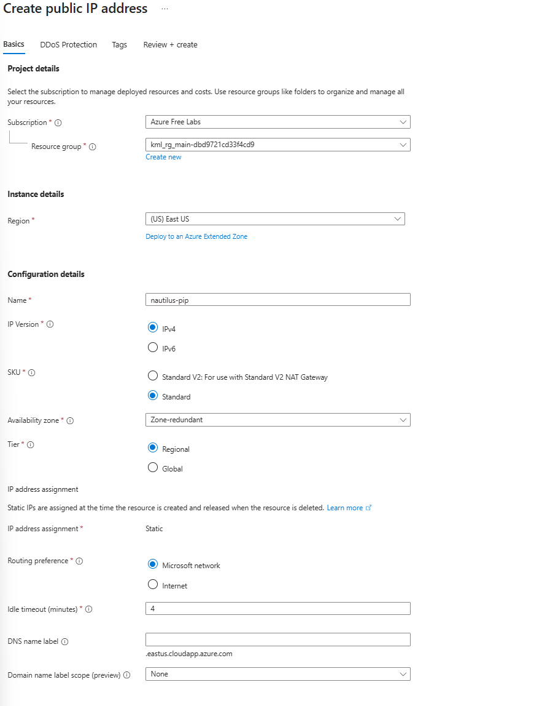
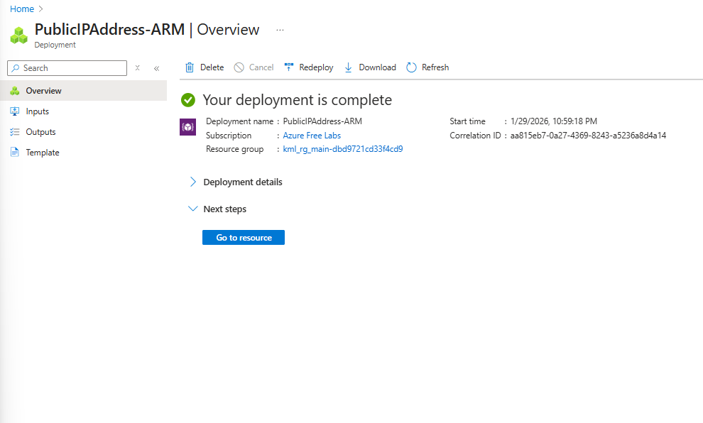
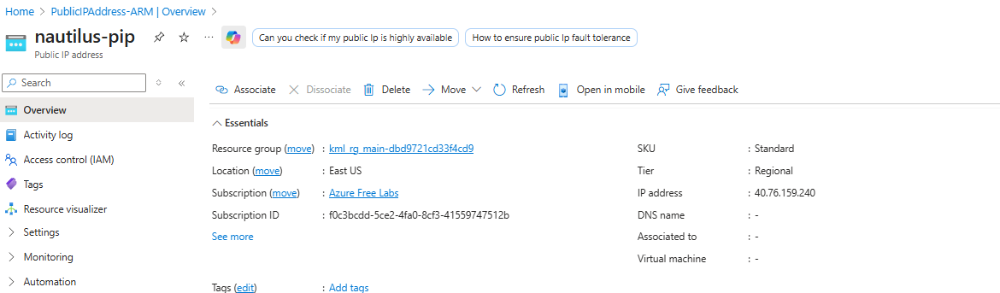

[← Back to KodeKloud 100 Days](/kodekloud)

# Overview

For this task I had to allocate a public IP address named `nautilus-pip`.

# What is an IP address?

An IP address is a unique number given to every device on a network.

**Public IP addresses** are unique across the whole internet and can be reached from it.

**Private IP addresses** are used inside local networks, like a home, an office or an Azure VNet, and can't be reached directly from the internet.

# Solution

Search for **Public IP addresses** in the search bar and click **+ Create**.

Most of the details can be left as default. I entered the name `nautilus-pip` and left it as IPv4, which is the standard and most widely used.

Then **Review + create**, wait for the "Validation passed" message, and click **Create**. The deployment takes around 10 to 30 seconds.

When it says "Your deployment is complete", click **Go to resource**. An IP address has been assigned (`40.76.159.240`).

# Notes

A public IP on its own doesn't do anything until it's attached to something, like a VM's network interface or a load balancer. Every public IP is a way in from the internet, so I'd only attach one to a VM if it really needs to be reachable, and lock it down with an NSG.
