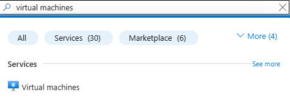
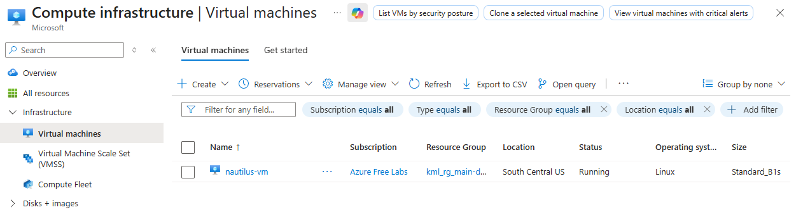
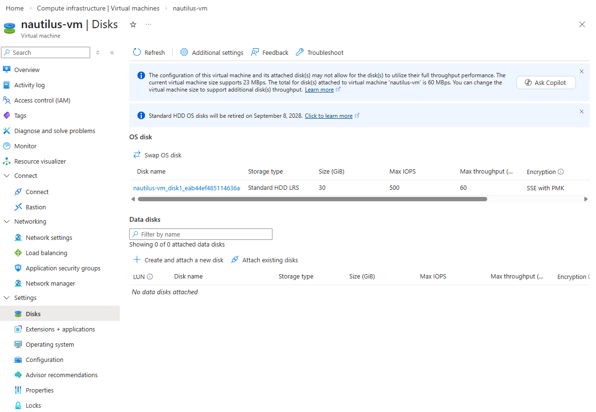
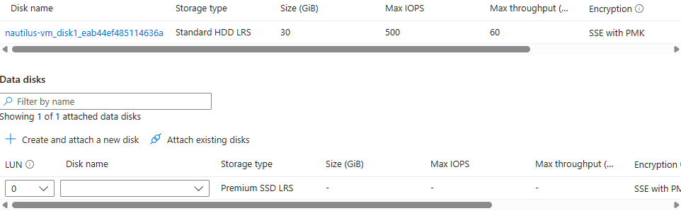
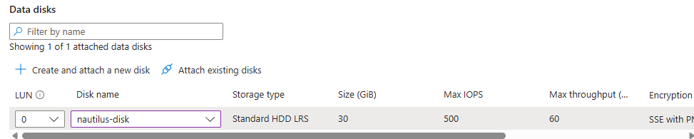
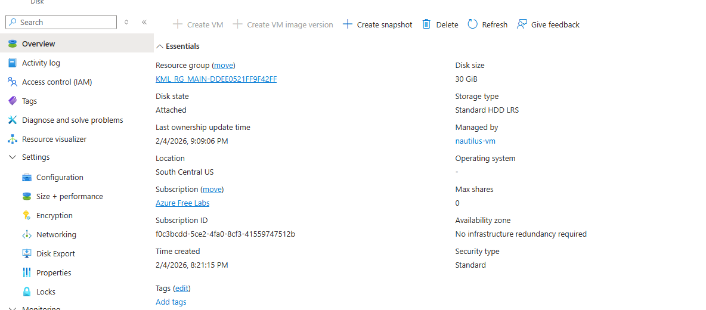

[← Back to KodeKloud 100 Days](/kodekloud)

# Overview

A VM named `nautilus-vm` and a managed disk named `nautilus-disk` already exist in the `southcentralus` region. The task was to attach `nautilus-disk` to `nautilus-vm` as a data disk, and make sure it's attached.

# What is a virtual disk?

A virtual disk works like a physical hard drive or SSD for a VM. The OS disk holds the operating system, and data disks hold applications and data. Keeping data on a separate disk means it can be detached and moved to another VM, or kept when the VM is deleted.

# Solution

Search for **Virtual machines** in the portal and select `nautilus-vm`.

Go to **Settings > Disks**.

Select **Attach existing disks**. A new row appears below, where I selected `nautilus-disk`.

Click **Apply** to attach it. After a few seconds it's fully attached to the VM.

Checking the disk itself, its state shows as **Attached**.

# Notes

Attaching the disk in Azure is only half the job on a real server. Inside the VM, a new data disk still has to be partitioned, formatted and mounted before anything can use it.
