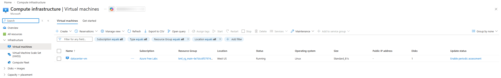
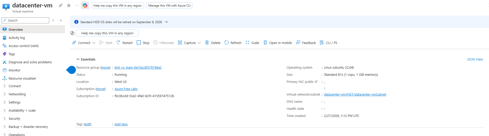
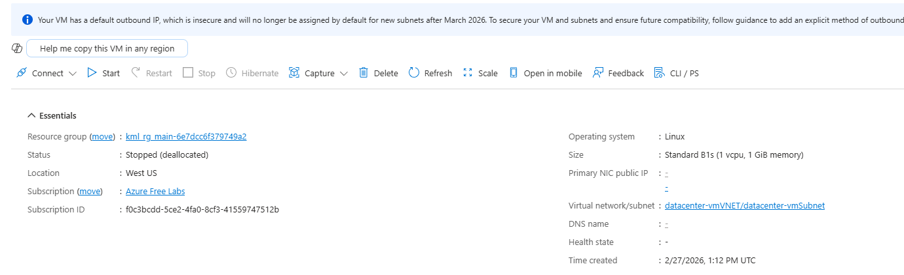
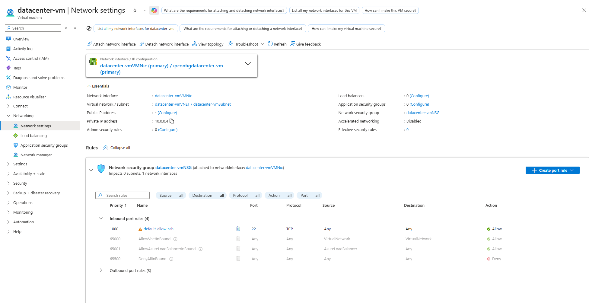
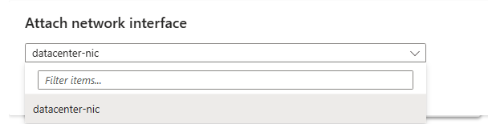
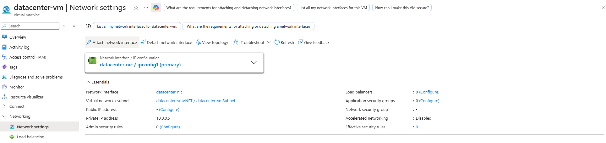
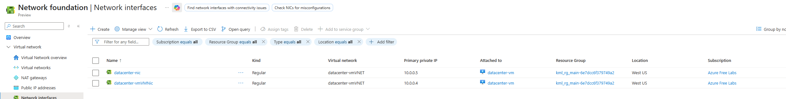
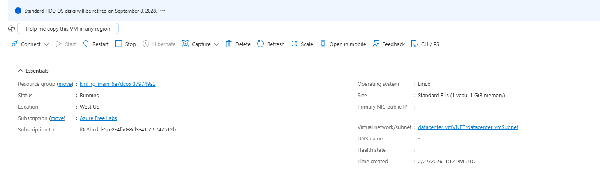

[← Back to KodeKloud 100 Days](/kodekloud)

# Overview

A VM named `datacenter-vm` and a network interface named `datacenter-nic` already exist in the `westus` region. The task was to attach `datacenter-nic` to `datacenter-vm`, and make sure its status is `attached`.

# What is a NIC?

A network interface card (NIC) is what connects a device to a network. In Azure, a VM uses a virtual NIC to connect to a virtual network (VNet).

Every Azure VM needs at least one NIC, otherwise it can't send or receive anything. The NIC is what gives the VM its private IP address, and optionally a public one, and connects it to a subnet in a VNet.

# Solution

Head to **Virtual machines**, where there's a VM named `datacenter-vm`. It's running.

It needs to be stopped first. Azure only lets you attach or detach network interfaces while a VM is stopped, so the VM stays stable during the change. Stopping it can take 1 to 2 minutes.

Once it's fully stopped, go to **Network settings**, which is where NICs are attached.

Select **Attach network interface**, choose `datacenter-nic` from the dropdown and select **OK**.

The NIC is now attached.

This can also be checked by searching for **Network interfaces** and seeing that `datacenter-nic` shows as attached to the VM.

After it's attached, the VM can be started again.

# Notes

A second NIC is usually used to put a VM in two subnets at once, for example a firewall or appliance VM with one side facing the internet and the other facing internal servers.
